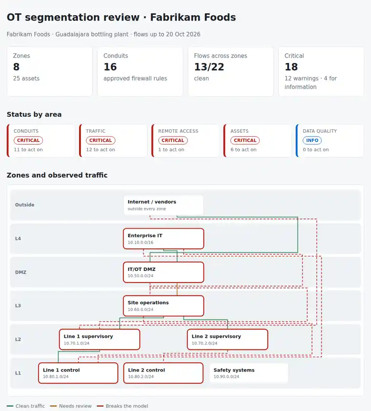

# OT Segmentation Lab

A plant network checked against the **Purdue model** and the **zones and conduits** idea of IEC 62443: the zones, the assets in them, the firewall rules that are supposed to connect them, and the traffic that actually crosses. A few CSV files, one Python command, and the answer to: **which paths into the control network should not exist, and which rules can be tightened without stopping the line?**

Python 3.10+, standard library only. Runs with fictional demo data out of the box. A learning lab.



## Why

On a plant network the risky paths are rarely the ones in the diagram:

- a **commissioning rule** that allows anything from the office network to the plant servers, still there years later;
- a **finance PC** that reads a PLC with Modbus because someone needed a number for a report;
- a **vendor** who connects with RDP straight to an HMI instead of going through the jump host;
- an **HMI** that calls the internet for updates;
- a **temporary rule** for an upgrade that expired a month ago and still carries traffic;
- the **safety PLC** in the same zone as the line controllers, reachable with the same protocol.

This lab puts the zone model, the rule set and the observed traffic side by side, and turns the gaps into a work list and a tighter rule set built from what the plant really uses.

## What it checks

| Area | Checks |
|---|---|
| Conduits | Rules that allow any service, or any host into L1/L2. Rules that bypass the DMZ, let the DMZ reach below L3, or skip a level. Expired and soon-expiring temporary rules. Rules with no approver. Rules with no matching traffic. |
| Traffic | Flows across zones with no approved conduit. Allowed flows that still break the model. Controller protocols (Modbus/TCP, S7comm, EtherNet/IP, DNP3…) from L3 or above. Cleartext admin protocols across zones. OT devices talking to the internet. Industrial traffic reaching the safety system. |
| Remote access | RDP, VNC, SSH or Telnet into OT that does not start on the jump host. |
| Assets | Devices seen on the network but missing from the inventory. Assets with no zone or outside their zone's subnet. End-of-life Windows in OT, critical in the cell. The safety system sharing a zone with control devices. |
| Data quality | Unknown zones in rules, duplicate zones, zones and critical assets without an owner. |

The rules of the model are in [docs/data-format.md](docs/data-format.md#rules-of-the-model).

Outputs:

- `report.html`: single file, light and dark mode. It has:
  - a Purdue diagram with every zone and the observed traffic between zones, coloured by status;
  - what to fix first, a zone-to-zone matrix and the rule set;
  - the proposed conduits built from observed traffic.
- `firewall-proposal.csv`: one line per host pair and service, with an action: `allow`, `review`, `re-route via DMZ` or `block`.
- `review.md`: fix first / this month / for the record, and the conduit changes to discuss.
- `actions.csv`: one row per action, worst first, with the zone owner and a `done` column.
- `zone-matrix.csv` and `findings.csv`.

How to run the review with the plant: [docs/segmentation-runbook.md](docs/segmentation-runbook.md).

## Try it

```bash
git clone https://github.com/inigogonzalezgarcia/26-ot-segmentation-lab.git
cd 26-ot-segmentation-lab
python -m otseg demo
```

Open `output/report.html` and `output/firewall-proposal.csv`.

### The demo data

The demo is a made-up bottling plant: Fabrikam Foods, Guadalajara, with two production lines, an IT/OT DMZ and a vendor who connects remotely. It has 8 zones, 25 assets, 16 conduits and a week of flows. Names, addresses and traffic are invented.

The gaps are placed on purpose:

- **Conduits:**
  - an "any service" rule from enterprise IT to site operations, with no approver;
  - PLC programming from L3 straight into a line's control zone;
  - an expired vendor VNC rule from the DMZ to an HMI that is still used;
  - a syslog rule nobody uses.
- **Traffic:**
  - a finance workstation reading a PLC with Modbus/TCP;
  - an HMI talking to the internet;
  - Telnet to the core OT switch;
  - an engineering workstation in line 2 with no conduit to the controllers.
- **Remote access:** a vendor RDP session straight into a Windows 7 HMI.
- **Assets:**
  - an unknown device on line 1 and a camera with no zone;
  - a PLC outside its subnet and two Windows 7 machines;
  - a safety PLC in the line 2 control zone that the HMI can reach.

The result: 13 of 22 cross-zone flows clean, 18 critical and 12 warnings, and a proposal to allow 13 host pairs, review 2, re-route 3 through the DMZ and block 4.

## Use it with your own plant

1. Export the zones and the asset inventory to `data/zones.csv` and `data/assets.csv` with the columns in [docs/data-format.md](docs/data-format.md).
2. Export the OT firewall rules to `data/conduits.csv`, and a week of flows from the firewall or NetFlow to `data/flows.csv`.
3. Run:

```bash
python -m otseg report data/ --out output/ --title "OT segmentation review · Plant 1"
```

Options: `--as-of 2026-10-20` (review date), `--expiring-days 14`, `--no-unused` (skip "unused rule" notes when the flow export is short).

Your files stay on your machine: `data/` and `output/` are in `.gitignore`.

## Tests

```bash
python -m unittest discover tests      # or: pip install -r requirements-dev.txt && python -m pytest
```

There are 16 tests:

- **Parsing:** Purdue levels, services and dates; a semicolon CSV with a BOM and Spanish headers.
- **Model:** the path rules (IT to DMZ, DMZ to L3, skipping a level), and a clean site with no findings where every flow is allowed.
- **Conduits:** any-service, any-host and path rules; expired and expiring temporary rules; unknown zones and the unused-rule switch.
- **Traffic:**
  - a flow with no conduit, and an IT workstation reaching a PLC;
  - an allowed flow that still breaks the model;
  - internet access from OT, cleartext protocols and devices missing from the inventory;
  - remote access with and without the jump host;
  - the actions in the proposed rule set.
- **Assets:** no zone, wrong subnet, end-of-life systems by level and criticality, a missing owner, and the safety system.
- **Demo end to end:** every check fires and all six outputs are written; missing input files exit cleanly.

**Next steps for your plant:**

- start with the zone list and the owners: one person per zone who approves its conduits;
- take a full week of flows before changing any rule, so the proposal covers every shift and changeover;
- tighten one zone at a time, starting from the any-service rules and the remote access paths.

## Background

Built from my work in IT operations, including:

- supporting data centre and IT-OT integration;
- operating Cisco switches and routers, comms rooms and racks, and FortiGate firewalls;
- managing connectivity providers and overseeing DR/BCP tests;
- running changes through CAB with a rollback plan.

The zone and conduit model of IEC 62443 is what I am studying now, and this lab is how I am learning it: the levels, the protocols and the checks are my reading of the model, written as code I can test.

Written from scratch with fictional data; no employer documents, rules or network data are used. It does not replace a risk assessment or the standard itself.

## Customisation and contact

Want this adapted to your plant? For example:

- importing rules straight from your firewall's export format;
- your own zone list, levels and security level targets;
- reading flows from your monitoring tool;
- a monthly report for the plant manager.

Get in touch:

- Website (contact form): [inigogonzalezgarcia.github.io](https://inigogonzalezgarcia.github.io/about.html#contacto)
- LinkedIn: [linkedin.com/in/igonzalez93](https://www.linkedin.com/in/igonzalez93)

## License

MIT
